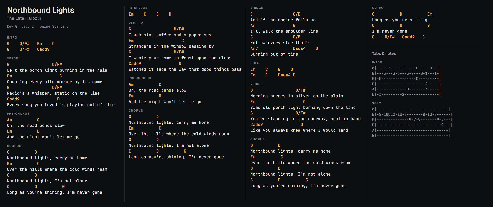

# ZXTabs

A Chrome and Edge extension that puts Ultimate Guitar tabs into a dark, full-screen reader. It lays the song out across as many columns as your window fits, so you can play straight through without scrolling. I built it for an ultrawide monitor, though it works on normal screens too.



- Chords stay lined up over the lyrics in an accent colour.
- **Auto** picks the column count that gives you the biggest text, and recalculates if you resize the window.
- **Fit** shrinks the text until the whole song fits on screen, down to an 11px minimum. If you set a font size by hand, the columns pack together on the left.
- The **Chords** view shows lyrics and chords. **Tabs** tacks any tablature, chord shapes and notes onto the end. Use either one, or turn on both.
- Transpose, fullscreen and keyboard shortcuts. The toolbar fades out while you play, and your settings save per song.

ZXTabs is an independent project. It is not affiliated with or endorsed by Ultimate Guitar.

## Install

This isn't on the web store, so you load it unpacked in Chrome or Edge.

From a release:
1. Download `zxtabs-<version>.zip` from [Releases](../../releases) and unzip it.
2. Open `chrome://extensions` (or `edge://extensions`) and turn on **Developer mode**.
3. Click **Load unpacked** and pick the unzipped folder.
4. Pin **ZXTabs Reader** from the extensions puzzle menu so the switch is easy to reach.

From source: run `npm install` and `npm run build`, then load the `dist` folder the same way.

## Use

Open any tab on [tabs.ultimate-guitar.com](https://tabs.ultimate-guitar.com), click the ZXTabs icon, and flip **Reader view**:
- When it's on, every UG tab opens straight into the reader, covering the page. Press `Esc` to see the normal UG page for that song.
- When it's off, UG works normally. Click **Reader** in the bottom right (or press `R`) to open the reader for just that song.

| Key | Action |
|---|---|
| `A` | Auto columns |
| `1`–`9` | Fixed number of columns |
| `C` / `T` | Chords and lyrics / tabs and notes |
| `-` / `=` | Smaller / bigger text (turns Fit off; the Fit button turns it back on) |
| `[` / `]` | Transpose down / up |
| `F` | Fullscreen |
| `Esc` | Back to the UG page |

## Privacy

ZXTabs only runs on `tabs.ultimate-guitar.com`. It reads the tab from the UG page you're on and saves your per-song settings in your browser's extension storage. Nothing is collected or sent anywhere else. The only outside request is to Google Fonts for Geist and JetBrains Mono.

## Develop

```sh
npm install
npm run build       # builds the extension into dist/
npm run typecheck
npm run package     # release/zxtabs-<version>.zip
```

After editing code, run `npm run build`, hit reload on the extension card in `chrome://extensions`, and refresh your UG tab.

Code layout:
- `src/ug.ts` pulls the song out of the JSON blob UG embeds in the page.
- `src/parse.ts` looks at each line and tags it as chords, lyrics, tablature or notes.
- `src/reader.ts` handles the CSS column layout and searches for the largest font size that fits.
- The whole UI mounts inside a shadow root so UG's styles and ours don't step on each other.

## License

[MIT](LICENSE)
